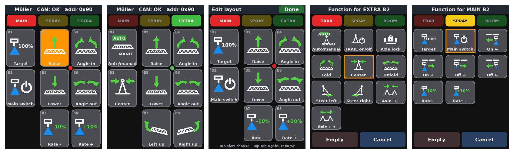

# AUX-N ISOBUS Touch Joystick

Érintőkijelzős ISOBUS AUX-N kezelő (Auxiliary Input Type 2) ESP32-re.
A kijelző a „gombsor”: 3, 6 vagy 8 gombos elrendezés, fölé cserélhető, 3D nyomtatott keret kerül tapintható vezetőnek (szamárvezető).

*Készítette: Balogh Dávid & Claude*

## Állapot: 0.7.0

- **AUX-N mód** (alap): még nem jelentkezik be a terminálra, és nem küld semmit (hardver ébresztés, 1. fázis).
- **Müller (ME) mód** (Beállítások → Mód): a gyári Müller permetező joystick AUX-O üzeneteit küldi, közvetlenül a Müller Jobcomputernek. JB3 stílus (sötét gombok, zöld nyilak), 3 színes fül (TRAIL piros / SPRAY sárga / BOOM zöld) + 8 gomb a joystick formájában. Szabad kiosztás: 3 fül × 8 hely, bármelyik helyre bármelyik Müller funkció (vagy üres); a fülnevek listából választhatók (TRAIL, SPRAY, BOOM, 1, 2, 3, MAIN, EXTRA). Alap: a gyári Müller kiosztás. Az üres fül eltűnik. Nyelv: English / Magyar. Terv: [docs/TERV_muller_mod.md](docs/TERV_muller_mod.md)

Közös alapok:

- kijelző + önteszt (színsávok, RGB LED, hang)
- érintés kalibrálás, a lapon tárolva (NVS)
- 3 / 6 / 8 gombos elrendezés, gombnyomás visszajelzéssel (narancs gomb, kék LED, kattanó hang, soros log)
- rezisztív érintés védelem: lenyomás csak 50 ms stabil érintés után; ha tartás közben ugrik a pont (pl. két ujj), azonnal elenged
- CAN figyelés 250 kbit/s-en (csak ACK-ol, nem ad): forgalom, eszközszám, VT (terminál) jelenléte
- beállítások menü

## Hardver (1. fázis)

| Lap | Kijelző | .bin |
|---|---|---|
| **3.5" ESP32-32E (E32R35T)**, fő cél | 320×480, ST7796U, XPT2046 rezisztív | `AuxN_TouchJoy_E32R35T_...` |
| 2.8" ESP32-32E (E32R28T) | 240×320, ILI9341V / ST7789, XPT2046 | `AuxN_TouchJoy_E32R28T_...` |

CAN: SN65HVD230 modul. 3.5"-on TX = IO25, RX = IO35; 2.8"-on TX = IO27, RX = IO35.

Bekötés: [docs/HARDVER.md](docs/HARDVER.md)

## Kezelés

| Mit | Hogyan |
|---|---|
| Elrendezés váltás (3→6→8) | BOOT gomb rövid nyomás (AUX-N módban) |
| Müller fül váltás (TRAIL → Permetezés → Keret) | fülre érintés, vagy BOOT rövid nyomás (Müller módban) |
| Mód: AUX-N / Müller | Beállítások → Funkciók >> → Mód |
| Kiosztás alaphelyzetbe | Beállítások → Funkciók >> → Kiosztás alaphelyzet (gyári Müller kiosztás, TRAIL B3 üres) |
| Kiosztás szerkesztése | Beállítások → Funkciók >> → Kiosztás szerk.: helyre koppintás → funkcióválasztó (3 csoport, Üres, Mégse); a kijelölt fülre újra koppintás → átnevezés |
| Nyelv | Beállítások → Nyelv / Language |
| Auto fényerő | Beállítások → Funkciók >> → Fényérzékelő: R21 letakarva → Sötét, lámpa → Világos (a lábat magától megkeresi). Utána Fény: … → Auto |
| Tájolás (fekvő / álló / 180°) | Beállítások → Tájolás (utána újrakalibrál). Álló módban: 3 gomb = 1×3, 6 = 2×3, 8 = 2×4 |
| CAN diagnosztika | Beállítások → Funkciók >> → CAN info |
| Beállítások | BOOT gomb 2 mp-ig nyomva |
| Kalibrálás | a nyitóképen 1 mp-ig érintsd a kijelzőt, vagy Beállítások → Kalibrálás |
| Panel típus (csak 2.8": ILI9341 ↔ ST7789) | a nyitóképen BOOT 2 mp (vakon is megy, LED: 1 villanás = ILI9341, 2 = ST7789), vagy Beállítások |
| Rossz színek | Beállítások → Invert / Szín (RGB/BGR); az önteszt sávjai: PIROS, ZÖLD, KÉK, FEHÉR |

### LED jelzések

| LED | Jelentés |
|---|---|
| zöld | van CAN forgalom |
| sárga villog | nincs CAN forgalom |
| piros | CAN hiba / bus-off |
| piros villog | a CAN driver nem indult |
| kék | gomb nyomva |

## Firmware letöltése, égetése

A GitHub Actions minden push után lefordítja a firmware-t, és a .bin fájlokat a **Releases** részbe teszi (repó főoldal, jobb oldalt → Releases → legfrissebb verzió → Assets).

- `..._FULL_0x0.bin`: első égetéshez, az Espressif online flasherrel, **0x0** címre
- `..._APP_OTA.bin`: csak az alkalmazás (későbbi OTA-hoz)

Soros konzol: 115200 baud (gombnyomások, CAN statisztika 5 mp-enként).

## Fejlesztés

- PlatformIO, Arduino keretrendszer, LovyanGFX
- Magyar ékezetes fontok: `tools/make_vlw.py` generálja a `src/fonts_hu.h`-t (DejaVu Sans Bold)
- Terv: [docs/TERV.md](docs/TERV.md)
- Natív (PC) tesztek: `g++ -std=c++17 -Isrc test/native_test.cpp src/keys.cpp src/muller_out.cpp -o t && ./t` (a CI is futtatja)
- Müller képernyő előnézet PC-n: `tools/icon_preview.cpp` + `tools/icon_preview.py`
