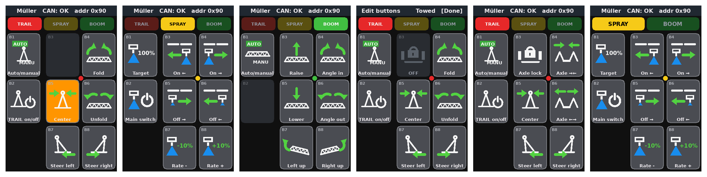

# Terv: Müller (ME) mód a Touch Joystickon

Készítette: Balogh Dávid & Claude, 2026-11-26
Állapot: **v0.5.0** (JB3 stílus, gépprofilok, gombszerkesztő, EN/HU), a buszon még nincs kipróbálva (a CAN modul csatlakozójára várunk).



## Cél

Az érintőkijelzős joystick a gyári Müller permetező Jobcomputernek közvetlenül tudjon parancsot adni, a Müller joystick
AUX-O üzeneteivel. A Müller gombok funkciója fix, ezért a kijelzőn minden gombon a valódi funkció ikonja látszik.

Referencia (bemért, a gyári Jobcomputerrel kipróbált): `docs/muller/`
- `TERV_muller_auxo.md`: küldő oldal (NAME, keretek, időzítés). Ez a mérvadó.
- `MullerJoystickAuxO.h` (v2): vevő oldali dekóder, gombszám táblázat. Ugyanezekkel a számokkal küldünk.
- `TERV_ME_joystick_gepekhez.md`: a saját gépek (permetező, szóró, vetőgép) oldala.

## Képernyő

- **Felül 3 fül, a váltó állása szerint:** TRAIL (0) / Permetezés (1) / Keret (2). Fülváltáskor minden gomb elengedett
  állapotba kerül (tartott funkciónál előbb `ss=0` megy ki).
- **8 gomb a joystick elrendezésében** (álló tájolás, 3 oszlop × 3 sor, bal alsó üres), hozzá külön „Müller” keret:

```
B1 | B3 B4
B2 | B5 B6
   | B7 B8
```

- A kiosztatlan gombok szürkék, „—” jellel, nem küldenek semmit.
- Ikonok: saját rajzolás a funkció szerint (a gyári grafika másolása nélkül), piros nyilak a mozgató funkcióknál.

## Gombkiosztás és akciófajta

Gombszám = váltóállás × 8 + belső index (B1=0 B2=1 B3=2 B5=3 B4=4 B6=5 B7=6 B8=7).

| Fül | Gomb | Szám | Funkció | Fajta |
|---|---|---|---|---|
| TRAIL | B1 | 0 | TRAIL kézi/auto | egyszeri nyomás |
| TRAIL | B2 | 1 | TRAIL be/ki | egyszeri nyomás |
| TRAIL | B3 | 2 | Tengely reteszelés (gyári JB3, lakat). A felhasználó gépén nincs → „Vontatott” profilban rejtve | egyszeri nyomás |
| TRAIL | **B4** | **4** | **Keret összecsukás** (a felhasználó gépén; hivatalosan tandem, kormányzott hátsó hidas gépen a híd funkciója → alternatív ikon) | pillanatnyi |
| TRAIL | **B5** | **3** | **Vonórúd középre** | **pillanatnyi (tartani kell)** |
| TRAIL | **B6** | **5** | **Keret kinyitás** (alternatív ikon: gyári tandem-híd) | pillanatnyi |
| TRAIL | B7 | 6 | Kormányzás balra | pillanatnyi |
| TRAIL | B8 | 7 | Kormányzás jobbra | pillanatnyi |
| Permetezés | B1 | 8 | Célérték 100% | egyszeri nyomás |
| Permetezés | B2 | 9 | Szakasz-főkapcsoló be/ki | egyszeri nyomás |
| Permetezés | B3 | 10 | Szakaszok be jobbról balra | nyomás (tartásra ismétel) |
| Permetezés | B4 | 12 | Szakaszok be balról jobbra | nyomás (tartásra ismétel) |
| Permetezés | B5 | 11 | Szakaszok ki balról jobbra | nyomás (tartásra ismétel) |
| Permetezés | B6 | 13 | Szakaszok ki jobbról balra | nyomás (tartásra ismétel) |
| Permetezés | B7 | 14 | Adag − | nyomás (tartásra ismétel) |
| Permetezés | B8 | 15 | Adag + | nyomás (tartásra ismétel) |
| Keret | B1 | 16 | Keret kézi/auto | egyszeri nyomás |
| Keret | B2 | 17 | szabad | – |
| Keret | B3 | 18 | Keret emelés | pillanatnyi |
| Keret | B4 | 20 | Behajlítás (szimmetrikus) | pillanatnyi |
| Keret | B5 | 19 | Keret süllyesztés | pillanatnyi |
| Keret | B6 | 21 | Kihajlítás (szimmetrikus) | pillanatnyi |
| Keret | B7 | 22 | Bal fel, jobb le | pillanatnyi |
| Keret | B8 | 23 | Jobb fel, bal le | pillanatnyi |

A „fajta” itt csak a kijelzés és a biztonsági viselkedés miatt fontos. Az üzenet mindig ugyanaz: amíg a gomb nyomva van,
megy az `ss=1`, majd 200 ms-onként az `ss=2`, és elengedésre az `ss=0`. A funkciót a Jobcomputer hajtja végre.

## Küldés (a bizonyítottan működő emulátor szerint)

- Saját control function Müller-szerű NAME-mel: gyártó 98, function 128, device class 13, industry group 2,
  self-configurable, **saját identity** (alap 0x1ABCDE; a valódi joystické 0x10C71D, így egyszerre lehetnek a buszon),
  kért cím 0x90. Address Claim, és válasz a Request for Address Claimre.
- Állapotüzenet: ID `0x1CE6FFxx` (prio 7, PGN 0xE600, global), adat `21 nn FF FF cc 00 ss FF`.
  - lenyomás: azonnal `ss=1`, a gomb `cc` számlálója +1
  - tartás: 200 ms-onként `ss=2`
  - elengedés: azonnal `ss=0`
- Másodpercenként `0xE700` keret (`FF 00 FF FF FF FF FF FF`), ahogy az emulátor. Teszt után dől el, elhagyható-e.
- Érvényes cím nélkül nem küld.

## Biztonság

- A tartott funkciókat a Jobcomputer a 200 ms-os ismétlés elmaradására állítja le. Az ismétlés saját, nem blokkolt
  időzítőn fut. A kijelző rajzolása, a kalibrálás és a menük nem akaszthatják meg; ha egy képernyő blokkolna,
  előtte minden gomb `ss=0`-val elenged.
- Érintés-ugrás (két ujj a rezisztív kijelzőn), fülváltás, képernyőváltás, beállítások megnyitása, CAN bus-off → minden
  gomb azonnal `ss=0`.
- A rezisztív kijelző egyszerre egy gombot kezel. A Müller kiosztásban nincs kétgombos kombináció, ezért ez itt nem gond.

## Gépprofilok és gombszerkesztő (v0.5.0)

A joystick mindig csak a gombszámot küldi; a profil csak azt dönti el, melyik gomb látszik / nyomható, és milyen ikonnal.

| Profil | TRAIL fül |
|---|---|
| Vontatott (saját, alap) | B3 rejtve, B4/B6 keret össze/kinyitás, B5 középre, B7/B8 kormányzás |
| Vontatott JB3 (gyári) | B3 lakat, B4/B6 gyári tandem-híd ikon |
| Önjáró | a TRAIL fül teljesen rejtve |

Gombszerkesztő: koppintás = Be → másik ikon (ha van) → Ki. Ha egy fül minden gombja ki van kapcsolva, a fül eltűnik, és a BOOT csak a látható fülek között vált. Szerkesztés után a profil „Egyéni”.

## Beállítások

- **Mód:** AUX-N / Müller / mindkettő. A Müller CF csak Müller vagy mindkettő módban jelentkezik be, hogy más gépeknél ne
  jelenjen meg idegen Müller eszköz a buszon.
- Haladó: Müller identity és kért cím.
- Az utoljára használt fül (váltóállás) megjegyezve.

## Megvalósítási sorrend

1. Hardveres teszt lezárása (kijelző, érintés, CAN-figyelés).
2. CAN küldés alapjai: address claim a Müller NAME-mel (AgIsoStack++ nélkül is megoldható, nyers TWAI-val).
3. Müller képernyő: 3 fül + 8 gomb a joystick formájában, ikonok.
4. Küldés + időzítés, teszt CANable-lel (`joystick_bemero.py --aux`), majd a gyári Jobcomputerrel, a valódi joystick
   kihúzva.
5. Biztonsági teszt: tartott keretfunkció közben a CAN bontása → a Jobcomputernek le kell állítania.
6. Utána az AUX-N réteg (AgIsoStack++, 8 bemenetes pool).
